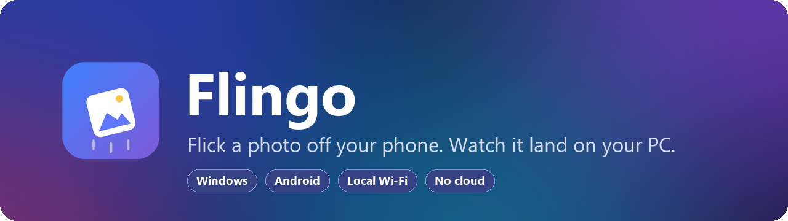
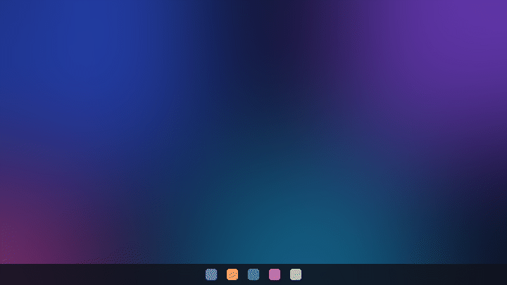
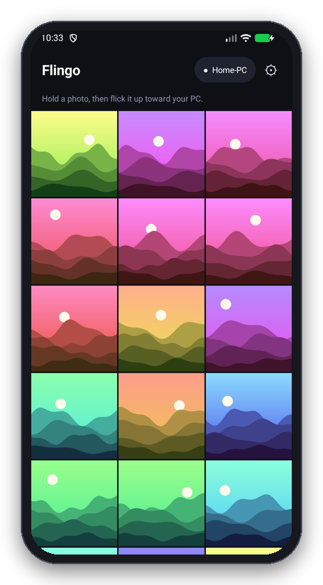
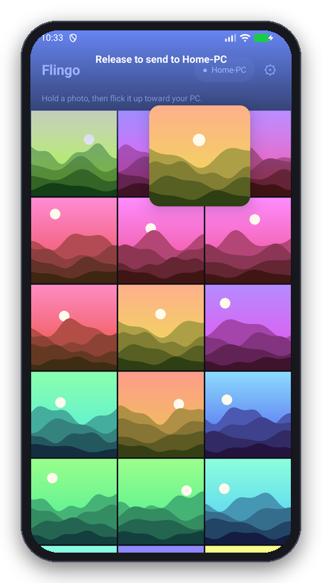
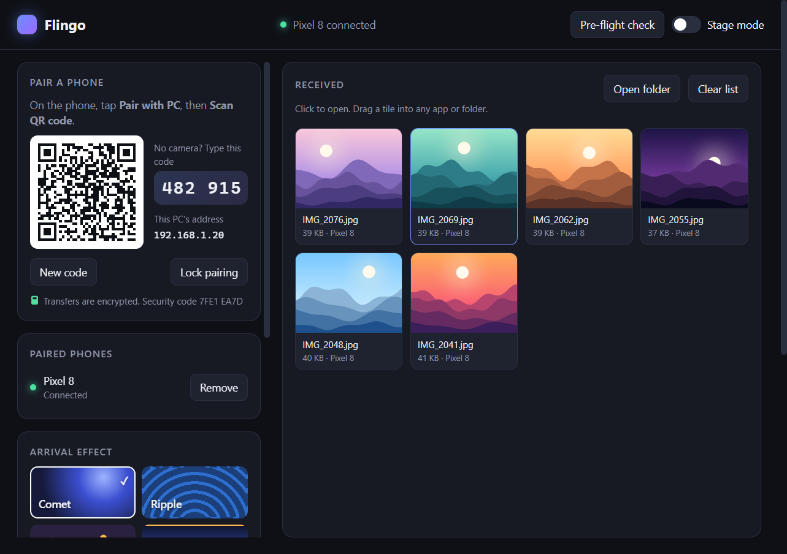
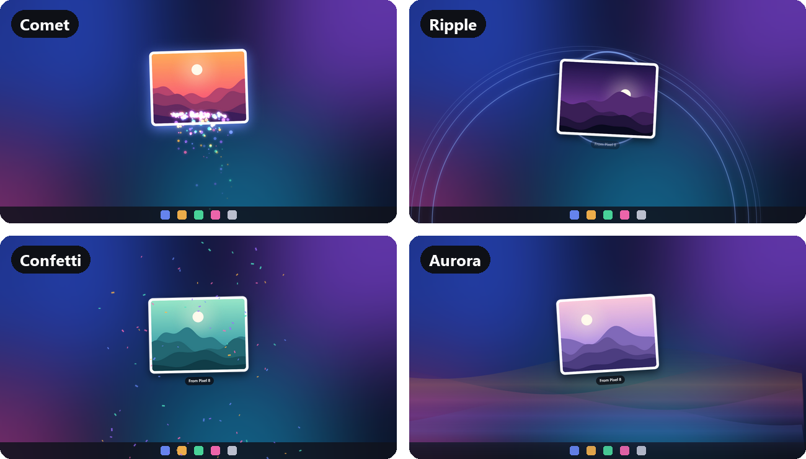
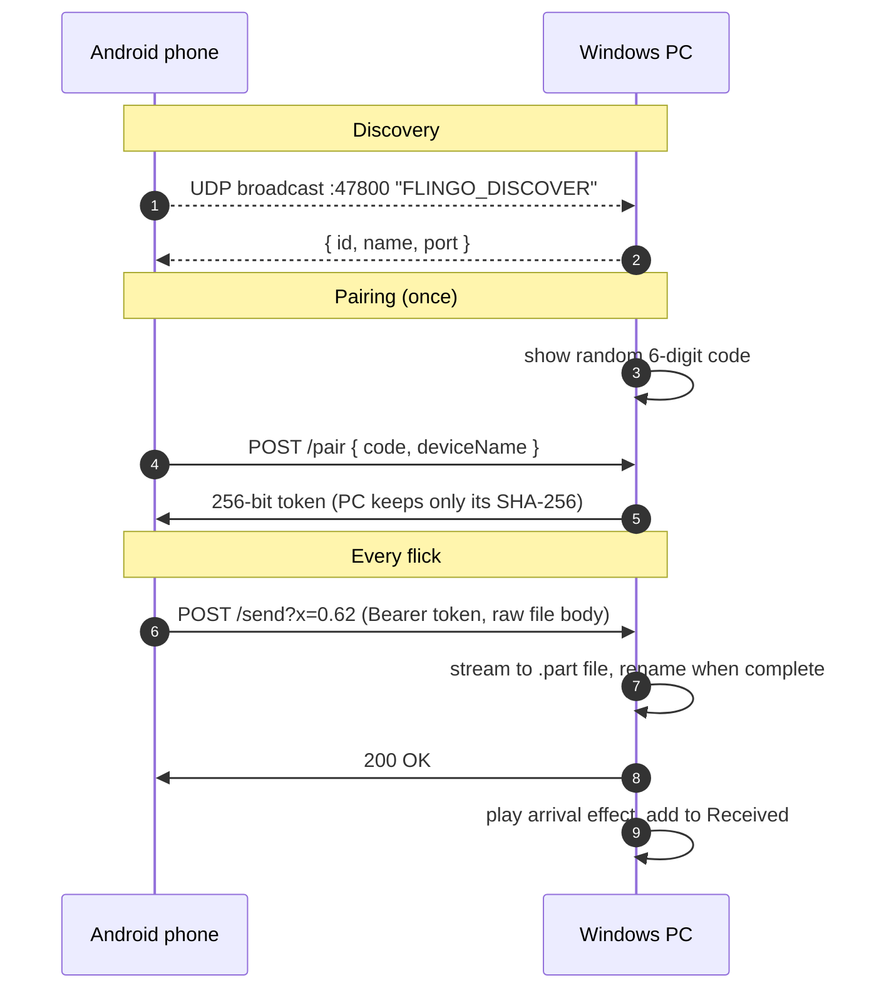

<p align="center">
  
</p>

<p align="center">
  
  
  
  
  
  
</p>

<p align="center">
  <b>Hold a photo. Flick it toward your laptop. It flies onto the screen and saves.</b><br>
  No cable, no cloud, no account. The file goes straight from the phone to the PC over your own Wi-Fi.
</p>

<p align="center">
  
</p>

---

## What you get

<table>
<tr>
<td width="50%" align="center" valign="top">
  <br>
  <b>Your gallery</b><br>
  <sub>Paired once, ready every time you open it.</sub>
</td>
<td width="50%" align="center" valign="top">
  <br>
  <b>Hold, then flick</b><br>
  <sub>The photo lifts and follows your finger. The top of the screen lights up as the send zone.</sub>
</td>
</tr>
<tr>
<td colspan="2" align="center">
  <br>
  <b>On the PC</b><br>
  <sub>Pairing code, effect picker, and everything you've received. Drag any tile into another app.</sub>
</td>
</tr>
</table>

| | Windows app | Android app |
|---|---|---|
| **Built with** | Electron, plain HTML/CSS/canvas | Native Kotlin, Android Views |
| **Runs as** | Tray app with a real window and Start menu shortcut | Regular app + system share target |
| **Size** | Standalone `Flingo.exe` | ~5 MB APK |

## Arrival effects

Each arrival plays on a full-screen transparent layer that ignores the mouse, so it never blocks what you're doing. Pick one on the PC:

<p align="center">
  
</p>

| Effect | What happens |
|---|---|
| **Comet** | The photo streaks in with a glowing particle trail |
| **Ripple** | Rings spread from where it entered and where it lands |
| **Confetti** | A burst when it lands |
| **Aurora** | Ribbons of light rise from the bottom edge |

Prefer silence? Turn off *Show arrivals on this PC* and files save quietly with a notification.

## The gesture

| Step | On the phone |
|:-:|---|
| **1** | **Hold** a photo. It lifts off the grid and follows your finger. |
| **2** | **Flick up**, or drag it into the glowing send zone at the top. |
| **3** | **Let go.** It leaves the top of the phone and enters the bottom of the PC screen, roughly where you threw it. |

Let go anywhere else and the photo snaps back. The send zone covers the top 10–50% of the screen (adjustable), and a fast upward flick sends from anywhere.

Flingo is also a **share target**: from any app, *Share → Flingo* sends files of any type.

## How it works



- **Discovery.** The phone broadcasts one small UDP datagram on each network interface. Any PC running Flingo answers with its name and port.
- **Pairing.** The PC shows a random 6-digit code. Each code works for one phone, then rotates. Five wrong guesses from one address lock it out for a minute.
- **Sending.** The file is streamed as the raw request body, so memory stays flat even for long videos. A dropped connection never leaves a half-written file.
- **Arrival.** The flick's horizontal position travels with the upload, so the photo enters the PC screen where you aimed it.

## Run it

### Windows

Requires Node.js 20+.

```bash
cd desktop
npm install
npm start
```

Build a standalone `Flingo.exe` (adds Start menu and desktop shortcuts on first launch):

```bash
npm run package
```

> [!IMPORTANT]
> The first time Flingo starts, Windows Firewall asks whether to allow it. Choose **Allow** for private networks, or the phone cannot reach the PC.

### Android

Requires Android Studio, or JDK 17–21 with the Android SDK. Runs on Android 10 or newer.

```bash
cd android
./gradlew assembleDebug
```

The APK lands in `android/app/build/outputs/apk/debug/app-debug.apk`. Copy it to the phone and install it.

### Pair

1. Open Flingo on the PC. It shows a 6-digit code.
2. Open Flingo on the phone and tap **Pair with PC**.
3. Pick the PC from the list and type the code.

> [!TIP]
> Some routers block broadcast. If the PC isn't listed, tap **Enter address** and type the address shown under the code.

