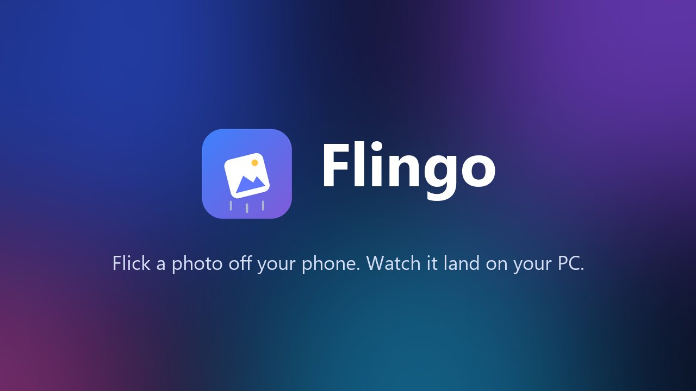
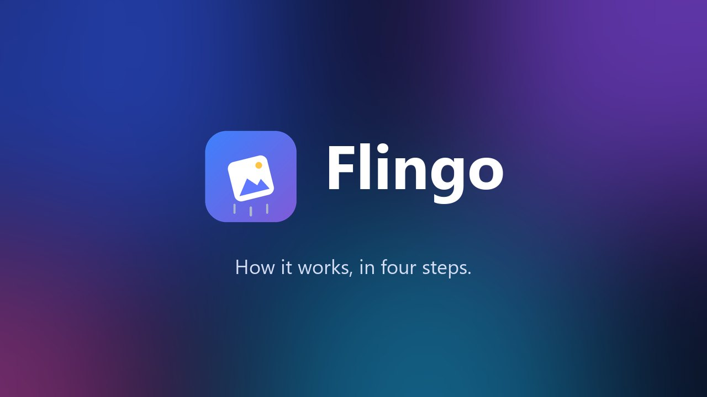
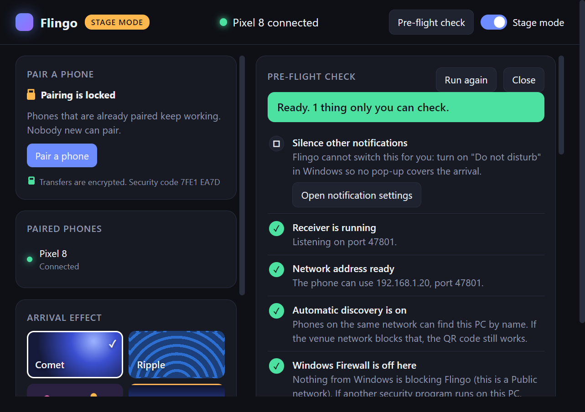
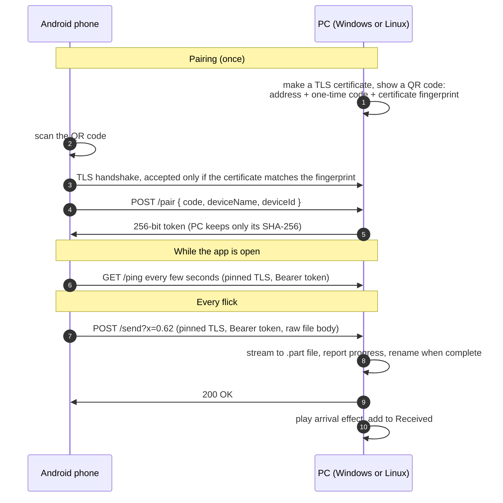

<p align="center">
  
</p>

<p align="center">
  
  
  
  
  
  
  
</p>

<p align="center">
  <b>Hold a photo. Flick it toward your laptop. It flies onto the screen and saves.</b><br>
  No cable, no cloud, no account. The file goes straight from the phone to the PC over your own Wi-Fi.
</p>

<p align="center">
  
</p>

<p align="center">
  <a href="https://lumidren.github.io/Windows-copy-move-tool-/"><b>Website and downloads</b></a>
  &nbsp;·&nbsp;
  <a href="https://lumidren.github.io/Windows-copy-move-tool-/#videos"><b>Watch the videos</b></a>
  &nbsp;·&nbsp;
  <a href="DEMO.md"><b>Live demo runbook</b></a>
  &nbsp;·&nbsp;
  <a href="ROADMAP.md"><b>Roadmap</b></a>
</p>

<table>
<tr>
<td width="50%" align="center">
  <a href="https://lumidren.github.io/Windows-copy-move-tool-/video/what-is-flingo.mp4"></a><br>
  <sub>▶ <b>What is Flingo?</b> (37 s)</sub>
</td>
<td width="50%" align="center">
  <a href="https://lumidren.github.io/Windows-copy-move-tool-/video/how-it-works.mp4"></a><br>
  <sub>▶ <b>How it works</b> (41 s)</sub>
</td>
</tr>
</table>

---

## What you get

<table>
<tr>
<td width="50%" align="center" valign="top">
  <br>
  <b>Your gallery</b><br>
  <sub>Paired once, ready every time you open it.</sub>
</td>
<td width="50%" align="center" valign="top">
  <br>
  <b>Hold, then flick</b><br>
  <sub>The photo lifts and follows your finger. The top of the screen lights up as the send zone.</sub>
</td>
</tr>
<tr>
<td colspan="2" align="center">
  <br>
  <b>On the PC</b><br>
  <sub>Scan the QR code to pair. Received photos sit on the right: drag any tile into another app.</sub>
</td>
</tr>
<tr>
<td colspan="2" align="center">
  <br>
  <b>Stage mode and pre-flight</b><br>
  <sub>For presenting: pairing locks, the display stays awake, and one button checks the whole path with a real test transfer.</sub>
</td>
</tr>
</table>

| | Desktop app (Windows, Linux) | Android app |
|---|---|---|
| **Built with** | Electron, plain HTML/CSS/canvas | Native Kotlin, Android Views |
| **Runs as** | A real window with a launcher entry; tray icon where the desktop has one | Regular app + system share target |
| **Ships as** | Windows installer, Linux `.deb` and `.tar.gz` | ~6 MB APK |

**Coming in 0.4.0** (on `main` now; the downloads below are still 0.3.0)

- **Updates itself.** Both apps ask GitHub which release is the newest, and offer it when it is not the one you have.
  - **Windows:** *Update now* downloads the installer, checks it against the release's checksum, and restarts into the new version.
  - **Android:** *Update* downloads the APK, checks it the same way, and hands it to Android, which asks before it installs.
  - **Linux:** the offer opens the download page, because installing a package needs your password.
- **Nothing installs without a click.** The check can be switched off in both apps, and the PC stays silent about updates in stage mode.
- **A tidier look.** The PC window has a bar of tabs down the left (Home, Phones, Arrivals, Settings, About), and Home shows one thing at a time: how to pair, then what has arrived; the phone's pairing choice is a clear three-way card, and both apps have an About screen.
- **Browse files.** The button that opens the phone's file browser, for a large video or any other file, is now labelled **Browse files** and outlined so it is easy to find. In 0.3.0 it is the small **Files** button.

**New in 0.3.0**

- **Send many at once.** Tap photos to select them, or pick "Today", "The last 7 days" or "Everything", then press **Send**. They arrive quietly: one progress card on the PC counts them in, with no flight per photo.
- **Flick a stack.** With photos selected, hold and flick one of them: that one flies in, the rest follow quietly.
- **Any file.** The **Files** button opens the phone's file picker for documents, archives and anything else.
- **Large files survive a dropped connection.** If the Wi-Fi blips, the phone waits, asks the PC how much arrived, and sends only the rest.
- **Keeps going in the background.** A long transfer continues when you switch apps or the screen turns off, with progress, speed and time left in a notification, and a Cancel button.

**New in 0.2.0**

- **Encrypted.** Every connection is TLS, and the phone pins the PC's certificate when it pairs.
- **QR pairing.** Scan the code on the PC. It works on networks that stop devices from finding each other.
- **Progress.** Large files show how far they have got, on the phone and on the PC screen.
- **Stays connected.** The phone checks the PC every few seconds, follows it to a new address, and says plainly when it cannot reach it.
- **Stage mode and pre-flight.** A presenting mode and a one-button check, described in the [live demo runbook](DEMO.md).
- **Any screen.** The arrival is sized as a share of the screen and tested from 720p to 4K at several scalings.

## Arrival effects

Each arrival plays on a full-screen transparent layer that ignores the mouse, so it never blocks what you're doing. Pick one on the PC:

<p align="center">
  
</p>

| Effect | What happens |
|---|---|
| **Comet** | The photo streaks in with a glowing particle trail |
| **Ripple** | Rings spread from where it entered and where it lands |
| **Confetti** | A burst when it lands |
| **Aurora** | Ribbons of light rise from the bottom edge |

Prefer silence? Turn off *Show arrivals on this PC* and files save quietly with a notification. Want more? Turn on the landing sound. With two screens, choose which one the arrivals appear on.

## The gesture

| Step | On the phone |
|:-:|---|
| **1** | **Hold** a photo. It lifts off the grid and follows your finger. |
| **2** | **Flick up**, or drag it into the glowing send zone at the top. |
| **3** | **Let go.** It leaves the top of the phone and enters the bottom of the PC screen, roughly where you threw it. |

Let go anywhere else and the photo snaps back. The send zone covers the top 10–50% of the screen (adjustable), and a fast upward flick sends from anywhere.

Flingo is also a **share target**: from any app, *Share → Flingo* sends files of any type.

**Moving a lot at once** (0.3.0) skips the show on purpose:

| To send | Do this | On the PC |
|---|---|---|
| **Several photos** | Tap each one, then **Send** | One card: "Receiving 24 files · 7 of 24", then "24 files received" |
| **A whole day or everything** | Tap one, tap the count, choose a range, then **Send** | The same single card |
| **A stack, with a flourish** | Select some, then hold and flick one | That one flies in; the rest arrive quietly |
| **Documents and other files** | **Files**, pick them | A card per file or per batch, no flight |

## How it works



- **Pairing.** The QR code carries everything the phone needs: where the PC is, a six-digit code that works once, and the fingerprint of the PC's certificate. Nothing has to be discovered, so it works on networks that isolate devices. Without a camera, the phone can find the PC by UDP broadcast or take a typed address, and then asks for the code.
- **Encryption.** The PC makes its own certificate on first run. The phone does not trust it through a certificate authority: it remembers the fingerprint from pairing and accepts only that certificate afterwards, at any address. Plain HTTP is switched off in the Android app altogether.
- **Sending.** The file is streamed as the raw request body, so memory stays flat even for long videos. A dropped connection never leaves a half-written file.
- **Staying connected.** The phone pings the PC while the app is open. If the PC stops answering it tries every address it knows, then looks for the PC by id, so a new address is found before the next flick rather than during it.
- **Arrival.** The flick's horizontal position travels with the upload, so the photo enters the PC screen where you aimed it.

## Get it

Every download is built by GitHub Actions from this repository and attached to the [latest release](https://github.com/lumidren/Windows-copy-move-tool-/releases/latest).

> [!NOTE]
> The latest release is **0.3.0**. It works with 0.2.0 on the other side, but selecting many photos, the Files button and resuming need 0.3.0 on both the phone and the PC. 0.1.0 cannot talk to anything newer, because every connection has been encrypted since 0.2.0.

| Platform | Download | Notes |
|---|---|---|
| **Android** 10+ | [`flingo.apk`](https://github.com/lumidren/Windows-copy-move-tool-/releases/latest/download/flingo.apk) | Open it on the phone and allow installing from your browser. |
| **Windows** 10 / 11 | [`Flingo-Setup.exe`](https://github.com/lumidren/Windows-copy-move-tool-/releases/latest/download/Flingo-Setup.exe) | Adds Start menu and desktop shortcuts. |
| **Linux** (Kali, Debian, Ubuntu) | [`flingo-linux.deb`](https://github.com/lumidren/Windows-copy-move-tool-/releases/latest/download/flingo-linux.deb) | `sudo apt install ./flingo-linux.deb` |
| **Linux** (any 64-bit distro) | [`flingo-linux.tar.gz`](https://github.com/lumidren/Windows-copy-move-tool-/releases/latest/download/flingo-linux.tar.gz) | Extract and run `./flingo`. |

> [!IMPORTANT]
> **Windows:** the first time Flingo starts, Windows Firewall asks whether to allow it. Tick **Private and Public** and choose **Allow**, or the phone cannot reach the PC. The **Pre-flight check** button in Flingo tells you if this went wrong.
>
> The installer is not code-signed yet, so Windows shows "Windows protected your PC" the first time. Choose **More info**, then **Run anyway**.

### Linux notes (Kali GNOME and friends)

- **GNOME has no tray.** Closing the Flingo window minimises it to the dock instead of hiding it, so it is always reachable. On desktops with a tray (Xfce, KDE) the tray icon appears as usual.
- **Wayland.** Flingo runs through XWayland, which is what gives the arrival overlay its transparency and click-through. No setup needed on a default GNOME session.
- **Firewall.** Kali ships without one enabled. If you use `ufw`, open the two ports:
  ```bash
  sudo ufw allow 47800/udp && sudo ufw allow 47801/tcp
  ```
- **Running as root.** Chromium refuses to start sandboxed as root. Use a normal user, or run `flingo --no-sandbox`.
- **Start at login** writes `~/.config/autostart/flingo.desktop`.

### Build from source

**Desktop** (Node.js 20+):

```bash
cd desktop
npm install
npm start
```

Installers: `npm run dist:win` on Windows, `npm run dist:linux` on Linux.

**Android** (Android Studio, or JDK 17–21 with the Android SDK):

```bash
cd android
./gradlew assembleDebug
```

The APK lands in `android/app/build/outputs/apk/debug/app-debug.apk`.

### Pair

1. Open Flingo on the PC. It shows a QR code.
2. Open Flingo on the phone and tap **Pair with PC**, then **Scan the QR code**.
3. Point the phone at the code. Click the code on the PC to enlarge it if you are standing back.

> [!TIP]
> No camera? Choose **Find my PC on this Wi-Fi**, or **Type the PC's address and code**. Both are shown next to the QR code.

Presenting to a room? Turn on **Stage mode** and read the [live demo runbook](DEMO.md).

## Under the hood

```
desktop/
  src/server.js     UDP discovery + HTTPS API (pair, ping, send, resume), limits, filename sanitising
  src/cert.js       the PC's TLS identity: a self-signed X.509 certificate built by hand
  src/preflight.js  the pre-flight checklist, including the Windows Firewall reading
  src/update.js     finds a newer release, downloads the installer, checks its SHA-256
  src/main.js       tray, windows, settings, pairing, stage mode, arrival screen, batches
  src/overlay.js    canvas arrival animation, the four effects, progress pills, sound
  src/index.*       main window: QR code, effects, phones, received list, checklist
  test/             receiver, certificate, pre-flight and updater tests; overlay at ten screen sizes
android/
  app/src/main/java/com/lumidren/flingo/
    Net.kt          pinned TLS, pairing, streaming upload that resumes, reconnection
    Transfers.kt    the send queue: batches, progress, speed, cancel
    TransferService.kt  keeps a long transfer alive in the background, with a notification
    Updater.kt      finds a newer release, downloads and checks the APK, hands it to Android
    UpdateReceiver.kt   opens Android's install prompt and reports how it went
    Gallery.kt      MediaStore query, thumbnail cache, grid adapter with selection
    MainActivity.kt hold-and-flick gesture, selection, pairing, connection status, share target
    ScanActivity.kt the QR scanner screen
    Prefs.kt        stored pairing and settings
```

| Problem | How Flingo handles it |
|---|---|
| **Trust without a certificate authority** | The PC's certificate is self-signed, so the phone pins its SHA-256 fingerprint instead. The QR code delivers the fingerprint by a path an attacker on the network cannot touch: light from the screen to the camera. |
| **Making a certificate with no dependencies** | Node can sign and parse certificates but cannot create one. `cert.js` encodes the X.509 structure in DER by hand (about 40 lines), signs it with ECDSA P-256, and the tests check it with Node's own parser and a real TLS handshake. |
| **Networks that isolate devices** | The QR code carries the PC's addresses, so pairing never depends on discovery. |
| **Wi-Fi with no internet** | Android sends an app's traffic over mobile data when Wi-Fi has no internet, which would make a hotspot or travel router useless. Every connection is bound to the Wi-Fi network explicitly. |
| **Scrolling vs. picking up** | A long press hands the touch stream from the scrolling list to the activity (a synthetic `ACTION_CANCEL` stops the list), so the two never fight. |
| **The PC's address changes** | The phone remembers the PC by id and by every address it had. A background ping notices the change and finds the PC again before the next flick. |
| **A connection that drops mid-file** | The phone names each transfer. If the connection drops, the PC keeps the part it has; the phone asks `GET /resume` how many bytes arrived and sends only the rest. Asking also ends the dead connection on the PC, which may not have noticed yet. |
| **Two hundred photos at once** | A batch carries its id, position and total size with every file. The PC folds them into one card, refreshes its window a few times a second instead of per file, and plays no flights unless the phone flicked. |
| **Leaving the app mid-transfer** | The queue belongs to the app, not the screen, and a foreground service with a wake lock holds it while the phone is locked or showing something else. |
| **Any screen, any refresh rate** | Sizes are a share of the screen and motion is measured in time, not frames. The photo is drawn once into a sprite, so a 50-megapixel picture costs the same per frame as a thumbnail. |
| **Hostile filenames** | Names are cut to a base name, stripped of characters Windows rejects and of invisible direction-override characters, guarded against device names like `CON` and `NUL`, and de-duplicated with ` (1)`, ` (2)`. Files that would run when opened are shown in their folder instead. |
| **Hostile clients** | One code per phone; five wrong guesses per address per minute; the code is replaced after twelve misses from anyone; pairing can be locked; uploads are capped in size, number and idle time; free space is checked first. |
| **Virtual network adapters** | VirtualBox, VMware, Hyper-V and WSL adapters are hidden, so the address shown is one a phone can actually reach. |
| **Updating without an app store** | Each app reads GitHub's public release list, and only trusts a download that comes from this project's releases and matches the SHA-256 the release declares. The phone also compares who signed the APK before asking Android to install it, so a mismatch is explained instead of failing oddly. The PC never checks while in stage mode. |
| **Dependencies** | The receiver uses only Node's `https`, `dgram`, `fs`, `crypto`. The desktop app adds one small library to draw the QR code. The phone adds one to scan it. |

**Tested how.** `npm test` runs 37 tests on the receiver, the certificate, the pre-flight logic and the updater (a download that was tampered with or cut short is thrown away), including 140 transfers in a row with every file compared byte for byte, and transfers that are cut off, carried on or cancelled. `npm run test:overlay` renders the real overlay at ten emulated screens, from 720p to 4K at 200%, and checks pixel by pixel that the photo lands centred, at the right size, and leaves nothing behind. Both run in CI on every push, alongside builds of all four downloads.

## How it compares

Flingo is not the only way to move a photo. This is where it sits, including where it loses.

| | **Flingo** | Quick Share | Phone Link | LocalSend | KDE Connect | PairDrop |
|---|:-:|:-:|:-:|:-:|:-:|:-:|
| Made by | this repo | Google | Microsoft | open source | KDE, open source | open source |
| Windows | ✅ | ✅ | ✅ | ✅ | ✅ | browser |
| Linux | ✅ | ❌ | ❌ | ✅ | ✅ | browser |
| Needs an account | no | optional | Microsoft account | no | no | no |
| Works with no internet | ✅ | ✅ | partly | ✅ | ✅ | needs its server to connect |
| Encrypted in transit | ✅ | ✅ | ✅ | ✅ | ✅ | ✅ |
| PC → phone | ❌ *(roadmap #6)* | ✅ | ✅ | ✅ | ✅ | ✅ |
| Steps to send a photo | hold + flick | share → pick device → accept | open app, find photo, drag | open app → pick file → pick device → accept | share → pick device | open tab on both → pick file |
| Arrival on the PC | animated, on screen, where you aimed | notification | inside the app | notification | notification | browser download |
| Scope | photos and files | files | calls, texts, notifications, photos | files and text | clipboard, notifications, remote input, files | files and text |

**Where the others fall short**

- **Quick Share** has no Linux app, leans on Bluetooth for discovery, and users regularly report phones that cannot see the PC.
- **Phone Link** needs a Microsoft account, is Windows-only, and treats files as a side feature of a much larger app.
- **LocalSend** is the most capable free option, but every send is a four-step form and the receiver has to accept.
- **KDE Connect** does a great deal, which makes setup heavier, and on GNOME it needs the GSConnect extension.
- **PairDrop** needs a browser tab open on both devices and reaches a signalling server before the devices can talk.
- **Blip** is fast, encrypted and works across the internet, but it needs an email sign-in and its own service, and its Linux version was still early-access when reviewed.
- **Canopy**, the Mac app whose Portal feature inspired this project, covers Apple devices only.

**Where Flingo is better:** one gesture, no account, no receiver prompt, and the only one that makes the arrival visible on screen at the spot you aimed for.

**Where Flingo is worse today:** one direction, Android-only on the phone side, installers that are not code-signed, and not yet in any app store. The [roadmap](ROADMAP.md) lists what closes these gaps, in priority order.

<sub>Comparison reflects the tools as generally documented in late 2026. Check each project for its current feature set.</sub>

## Limits

- Both devices must be on the same local network, or one must be the other's hotspot.
- One direction only: phone to PC.
- Pairing by **typed code** trusts the certificate the PC presents on that first connection. Pairing by **QR code** does not have that gap, because the fingerprint arrives through the camera. After a typed pairing, compare the security code on the phone with the one on the PC.
- The arrival shows the picture itself for JPEG, PNG, GIF, WebP and AVIF. Videos, HEIC photos and other files arrive intact but animate as a file card.
- A transfer that is carried on after a drop is not checksummed end to end; TLS protects each part in flight, and the PC checks the final size.
- The Windows installer is not code-signed, so Windows warns the first time you run it.
- Android only installs an update signed with the same key as the app already on the phone. Releases up to 0.3.0 were signed with throwaway keys, so moving on from them means uninstalling once. [RELEASING.md](RELEASING.md) describes the key that later releases are signed with.
- The update check needs the internet for a moment; everything else works without it. Linux copies are told about an update but do not install it themselves.
- Tested on an Android emulator, on Windows 11, and in CI. Not yet checked on real Kali hardware, on a phone hotspot, or on a second screen in extended mode. The [demo runbook](DEMO.md) lists exactly what is and is not verified.

<sub>The screenshots and animation above are real captures from the running apps. The landscape pictures in them are generated sample images, not anyone's photos.</sub>

## License

MIT © lumidren
